# block

Mermaid's documentation examples, from Pele 1.13.0's test corpus; each renders on the site. Written by `pnpm run vendor-artifact-share` in opencode-office; don't edit.

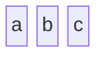

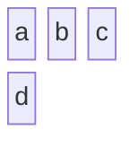

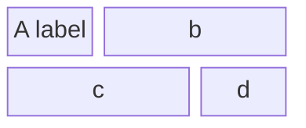

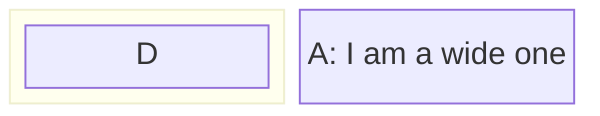

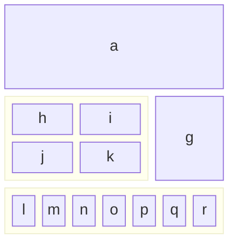

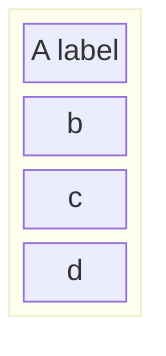

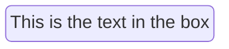

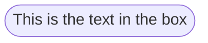

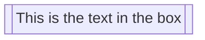

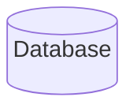

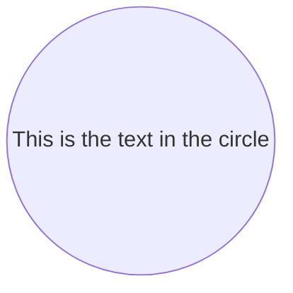

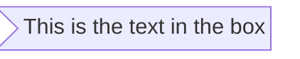

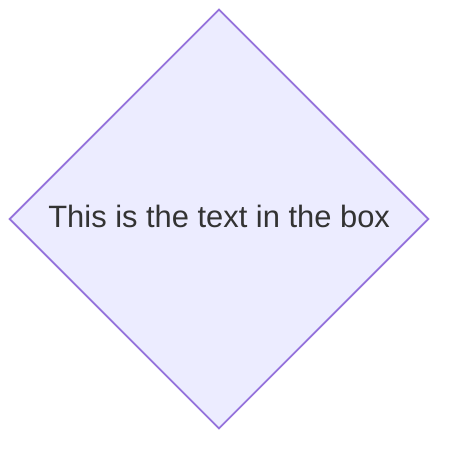

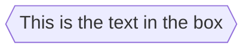

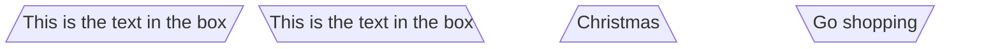

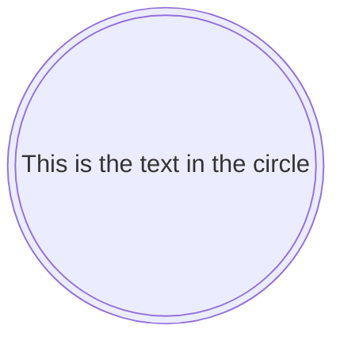

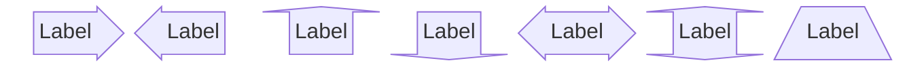

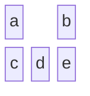

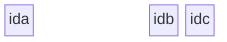

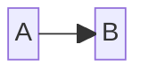

```mermaid
block
  A space:2 B
  A-- "X" -->B
```

```mermaid
block
  A space B
  A --> B
```

```mermaid
  block
    A
    style A fill#969;
```
